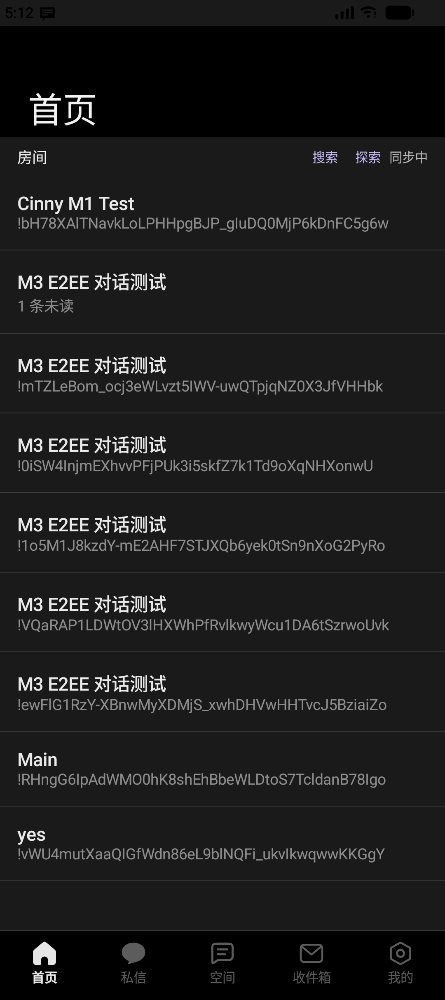
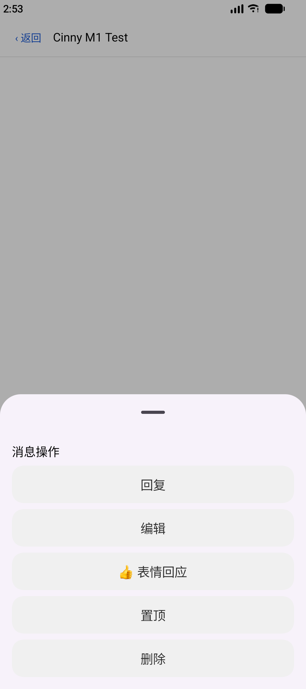
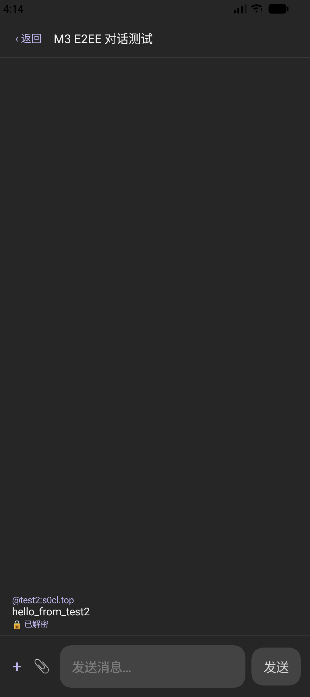
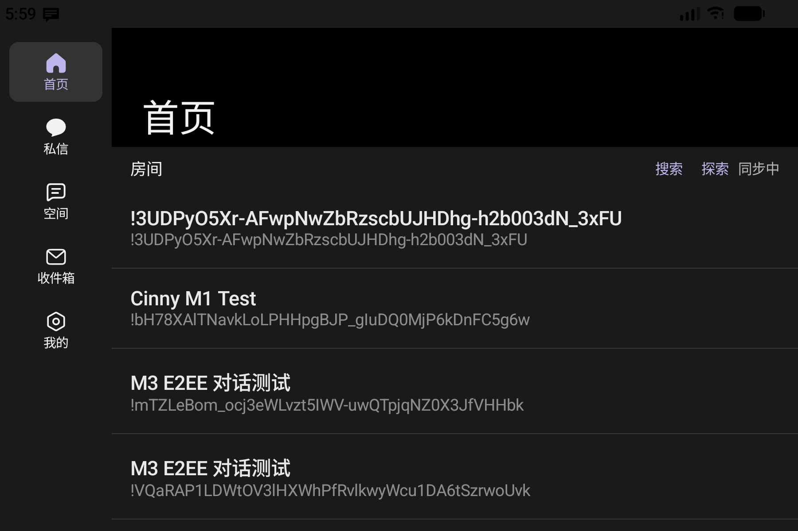
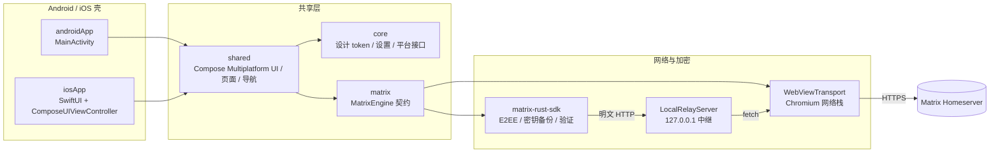

<div align="center">

# CinnyClient

**Cinny 的 Kotlin Multiplatform 移动端移植**  
Compose Multiplatform 共享 UI · Android 优先 · iOS 复用共享 UI（接口适配中）

[](https://kotlinlang.org/docs/multiplatform.html)
[](https://www.jetbrains.com/lp/compose-multiplatform/)
[](https://developer.android.com/)
[](LICENSE)
[](docs/PROJECT_STATUS.md)

</div>

CinnyClient 是一个基于 [Matrix](https://matrix.org/) 协议的移动端即时通讯客户端，将 [Cinny](https://github.com/cinnyapp/cinny) 的界面与交互移植到 **Kotlin Multiplatform + Compose Multiplatform**。Android 端已具备完整的登录、房间列表、消息时间线、媒体、Spaces、Thread、E2EE、密钥备份、推送与通话能力岛；iOS 端复用共享 UI，目前只维护接口与适配文档。

> 本项目是社区移植项目，与 Cinny 官方无直接关系。

## 截图

<table>
  <tr>
    <td align="center"><br><sub>首页（深色）</sub></td>
    <td align="center"><br><sub>消息操作面板</sub></td>
    <td align="center"><br><sub>E2EE 消息解密</sub></td>
    <td align="center"><br><sub>平板 / 横屏双栏</sub></td>
  </tr>
</table>

## 功能特性

| 领域 | 已实现 |
| --- | --- |
| 认证与会话 | 密码登录、`/_matrix/client/v3` 登录 / sync、会话恢复、token 自动刷新、退出登录 |
| 聊天 | Home / Direct 房间列表、时间线、纯文本与富文本（mention、spoiler、代码、列表、引用）、贴纸、URL 预览 |
| 消息操作 | 回复（`m.in_reply_to`）、编辑（`m.replace`）、删除（redact）、表情回应（`m.reaction`）、置顶、Thread 回复与独立视图、转发、编辑历史 |
| 媒体 | 图片 / 视频 / 音频 / 文件上传下载，分块 JS bridge 传输，加密媒体经 rust-sdk 下载解密，图片 LRU 缓存 |
| Spaces | 空间列表与 Lobby、创建空间、排序（`in.cinny.spaces`）、长按拖拽、嵌套折叠、添加已加入房间 |
| 搜索 / 收件箱 / 探索 | 全服搜索、房间与发送者过滤、跳转到事件；邀请接受 / 拒绝；公共房间发现 |
| 端到端加密 | matrix-rust-sdk 26.10.23、交叉签名、设备指纹、密钥备份 / Secret Storage、SAS 表情验证 |
| 推送与通话 | 通知渠道、UnifiedPush topic、本地通知（解密后展示）、WebView widget 通话宿主、摄像头 / 麦克风权限代理、画中画入口 |
| 适配 | 600 / 840dp 断点、双栏布局、横竖屏、RTL、字体缩放、48dp 触控热区、基础无障碍 |
| 设置 | 主题（浅色 / 银色 / 深色 / 黄油 / 跟随系统）、自动加载媒体、Enter 发送、消息布局、通知开关 |

## 架构



**为什么有 WebView 传输层？** 部分自建 homeserver 前置 WAF 只放行 Chromium 的 TLS ClientHello，rustls / OpenSSL / Java TLS 会在握手阶段被重置。项目因此提供 `WebViewTransport` 作为网络通道，并用 `LocalRelayServer` 让 matrix-rust-sdk 复用同一套 Chromium TLS 指纹。这是针对受限网络的兼容方案，不改变 Matrix 协议语义；在普通 homeserver 上同样可用。

## 模块与目录

| 路径 | 说明 |
| --- | --- |
| `androidApp/` | Android 应用壳（`MainActivity`、权限、通知、引擎装配） |
| `iosApp/` | iOS 应用壳（SwiftUI + `ComposeUIViewController`） |
| `shared/` | Compose 页面、导航、业务 UI；`src@android` / `src@ios` 为平台实现 |
| `matrix/` | `MatrixEngine` 契约、内存引擎、WebView 传输、本地中继、加密服务、通知 |
| `core/` | 设计 token（`CinnyColors` / `CinnyScales`）、主题、设置模型、平台接口 |
| `tools/design/` | 从 Cinny / folds token 生成设计 token 的脚本 |
| `scripts/` | 构建 / 测试 / 运行封装脚本，日志统一写入 `logs/` |
| `docs/` | 阶段验证记录、项目状态、iOS 适配文档 |
| `project.yaml` | Kotlin Toolchain 工程配置（模块注册） |
| `libs.versions.toml` | 依赖版本目录 |

> `cinny/` 是上游 Cinny Web 客户端的只读参考检出，**不随仓库分发**。需要生成或校验设计 token 时自行 clone：
>
> ```sh
> git clone https://github.com/cinnyapp/cinny.git cinny
> ```

## 环境要求

- **JDK 21**（Kotlin Toolchain 自带的 wrapper 也会在首次运行时下载所需 JRE）
- **Android SDK**：`compileSdk 37`、`targetSdk 37`、`minSdk 33`
- **iOS**（可选）：macOS + Xcode；当前仅维护接口与文档
- 首次构建需要网络：`kotlin` / `kotlin.bat` 会自动下载固定版本的 [Kotlin Toolchain](https://kotlin-toolchain.org/dev/)（0.13.0）

## 快速开始

```sh
git clone https://github.com/yuxiangll/CinnyApp.git
cd CinnyApp

# 构建 Android
./kotlin build -p android

# 运行测试
./kotlin test -p android

# 安装并启动（需要已连接设备或模拟器）
./kotlin run -m androidApp
```

Windows 使用 `kotlin.bat`：

```bat
kotlin.bat build -p android
kotlin.bat test -p android
```

### 使用脚本（推荐）

脚本会把完整日志写入 `logs/`，失败时直接打印关键片段：

```sh
# Linux / macOS / Git Bash
./scripts/build.sh      # -> logs/build.log
./scripts/test.sh       # -> logs/test.log
./scripts/run.sh        # -> logs/install.log、logs/logcat.log

# Windows cmd / PowerShell
scripts\build.bat
scripts\test.bat
```

也可以自行重定向（`logs/` 已在 `.gitignore` 中）：

```sh
./kotlin build -p android > logs/build.log 2>&1
./kotlin test  -p android > logs/test.log  2>&1
```

`logs/` 可随时清空，不影响 `build/` 下的构建产物。

### 设计 token

```sh
node tools/design/generate-design-tokens.mjs          # 重新生成
node tools/design/generate-design-tokens.mjs --check  # 校验是否与 Cinny 一致
```

生成结果写入 `core/src/top/s0cl/cinny/core/design/CinnyColors.kt` 与 `CinnyScales.kt`，请勿手工编辑。

## 当前进度

| 阶段 | 状态 | 内容 |
| --- | --- | --- |
| M0 | ✅ 完成 | 工程基线、模块拆分、设计 token、导航壳、WebView 桥接、16KB / ABI |
| M1 | ✅ 完成 | 认证、会话、sync、房间列表、时间线、纯文本发送、已读回执 |
| M2 | ✅ 基本完成 | 媒体、Thread、转发、编辑历史、搜索过滤、Spaces 拖拽 / 嵌套、富文本 |
| M3 | ✅ 完成（受限项） | E2EE、密钥备份、SAS 验证、推送、通话能力岛、开发者工具 |
| M4 | 🟡 进行中 | 响应式断点、平板双栏、横竖屏、RTL、字体缩放、图片缓存、基础无障碍 |
| M5 | ⬜ 未开始 | Release 签名、R8、Baseline Profile、AAB、TestFlight / App Store |

详细记录见 [`docs/PROJECT_STATUS.md`](docs/PROJECT_STATUS.md) 与各阶段验证文档。

## 已知限制

- 推送依赖服务器支持 HTTP pusher；部分服务器返回 `405 M_UNRECOGNIZED`，此时无后台离线推送。
- 历史加密消息若缺少会话密钥，会显示“缺少会话密钥”，这是矩阵协议的正常行为。
- WebView 传输是兼容方案，大文件经 base64 / 分块桥接，性能与长连接仍有优化空间。
- `minSdk 33` 受 `miuix-blur` 限制；如需覆盖 Android 8–12 需要专项改造。
- iOS 端目前只维护接口与文档，未进行测试开发。
- 折叠屏铰链、TalkBack 全量走查、对比度审计尚未完成。

## 文档

- [`docs/PROJECT_STATUS.md`](docs/PROJECT_STATUS.md) — M0–M5 总览与当前状态
- [`docs/M0_VERIFICATION.md`](docs/M0_VERIFICATION.md) — 工程基线
- [`docs/M1_VERIFICATION.md`](docs/M1_VERIFICATION.md) — 认证与基础消息
- [`docs/M2_VERIFICATION.md`](docs/M2_VERIFICATION.md) — 媒体、消息操作、搜索、Spaces
- [`docs/M3_VERIFICATION.md`](docs/M3_VERIFICATION.md) — E2EE、推送、通话、开发者工具
- [`docs/M4_VERIFICATION.md`](docs/M4_VERIFICATION.md) — 响应式、RTL、性能、无障碍
- [`docs/ios/README.md`](docs/ios/README.md) — iOS 适配说明
- [`AGENTS.md`](AGENTS.md) — 面向 AI 编码助手的工程约定

## 参考与致谢

- [Cinny](https://github.com/cinnyapp/cinny) — 界面、交互与设计 token 的来源
- [MIUIX](https://github.com/miuix-kotlin-multiplatform/miuix) — Compose Multiplatform 组件库
- [matrix-rust-sdk](https://github.com/matrix-org/matrix-rust-sdk) — E2EE、密钥备份与设备验证
- [Kotlin Multiplatform](https://www.jetbrains.com/help/kotlin-multiplatform-dev/get-started.html) · [Compose Multiplatform](https://www.jetbrains.com/lp/compose-multiplatform/) · [Kotlin Toolchain](https://kotlin-toolchain.org/dev/)

## 许可

本项目沿用上游 Cinny 的 [GNU Affero General Public License v3.0](LICENSE)（AGPL-3.0）。
